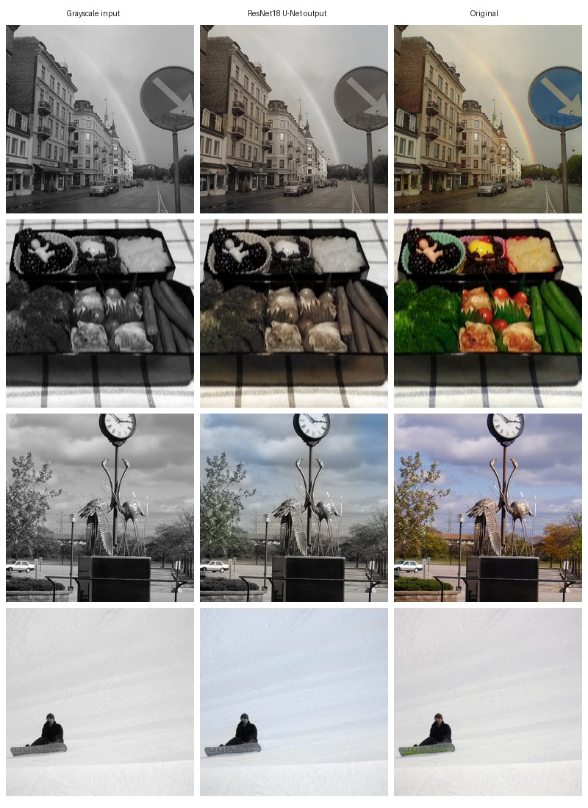

# ChromaAI: Automatic Image Colorization with Deep Learning

ChromaAI turns grayscale photos into colour images. It **trains and benchmarks five deep-learning architectures**
on the same data: a convolutional autoencoder, a classic U-Net, an Attention U-Net, a Pix2Pix GAN generator and
a ResNet18-encoder U-Net. The best one is served in an interactive **Streamlit** app.



*Unseen test images: grayscale input → ResNet18 U-Net prediction → original.*

---

## How it works

Images are converted to the **CIE Lab** colour space. The network sees only the lightness channel **L** and predicts the two
colour channels **a, b**. The predicted colour is then combined with the original full-resolution L channel,
so fine detail is kept even though the model runs at 128×128.

```
RGB image ──► Lab ──► L (input, 1×128×128) ──► CNN ──► ab (output, 2×128×128)
                                                         │
                         full-resolution L  ◄────────────┘ upsample + merge ──► RGB
```

## Models compared

| Model | Idea | Params |
|---|---|---|
| Conv Autoencoder | Encoder–decoder baseline, no skip connections | 14.0 M |
| Classic U-Net | Skip connections keep spatial detail | 7.8 M |
| Attention U-Net | Attention gates weight the skip features | 7.9 M |
| Pix2Pix U-Net | Generator from the conditional-GAN paper (trained here with L1) | 41.8 M |
| **ResNet18 U-Net** | **ImageNet-pretrained ResNet18 encoder + U-Net decoder** | **14.4 M** |

There are also extra experiments: adversarial training (`train_gan.py`, PatchGAN discriminator + λ·L1) and colour
**classification** over quantised ab bins with class re-balancing (`train_class.py`), which tackles the
"grey/sepia average" problem of regression losses.

## Results

All models use the same data, the same image size (128×128) and the same number of epochs.
Test set: 749 unseen images.

| Model | Test L1 ↓ | PSNR (dB) ↑ | SSIM ↑ | Avg. rank |
|---|---|---|---|---|
| **ResNet18 U-Net** | **0.0735** | **24.29** | **0.924** | **1** |
| Classic U-Net | 0.0806 | 23.77 | 0.921 | 3 |
| Attention U-Net | 0.0802 | 23.76 | 0.920 | 3 |
| Conv Autoencoder | 0.0804 | 23.79 | 0.917 | 3 |
| Pix2Pix U-Net | 0.0867 | 23.03 | 0.892 | 5 |

**Findings**
- The **pretrained encoder made the biggest difference**: ResNet18 U-Net ranks first on every metric. ImageNet
  features already "know" what grass, sky and skin look like.
- Skip connections (U-Net) clearly beat the plain autoencoder on SSIM, because structure is preserved.
- **Limitation:** like most L1-trained colorizers, outputs are less saturated than reality. The mean predicted
  chroma is 7.9 vs. 15.1 in the real images. The classification and GAN variants in this repo are the first
  steps towards more vivid colour.

Full metrics: [`results/comparison.csv`](results/comparison.csv) ·
[`results/full_comparison.csv`](results/full_comparison.csv) · training curves: [`results/history.json`](results/history.json)

## The app

`streamlit run app.py` opens **ChromaAI** with four tabs:
- **Colorize:** upload a photo, pick a model, drag a before/after slider, adjust colour vibrance and download the result
- **Model comparison:** benchmark metrics and charts for all architectures
- **Architecture & Why U-Net:** diagrams and an explanation of each network
- **How it works:** the Lab colour space, dataset and method

## Project structure

```
ChromaAI/
├── app.py                 # Streamlit app
├── requirements.txt
├── src/
│   ├── download_data.py   # Downloads MS-COCO val2017 and makes a 70/15/15 split
│   ├── dataset.py         # Lab-space dataset
│   ├── models.py          # The 5 architectures + colour classifier
│   ├── engine.py          # Training / validation loop
│   ├── compare.py         # Trains and benchmarks all models
│   ├── train_best.py      # Longer training of the best model
│   ├── train_gan.py       # Adversarial (PatchGAN) training
│   ├── train_class.py     # Colour-bin classification training
│   ├── evaluate.py        # L1, PSNR, SSIM, chroma metrics
│   ├── infer.py           # Inference helpers
│   └── architecture_tab.py
├── results/               # Metrics CSVs, training history, plots
└── checkpoints/           # Trained weights (not stored in git, see below)
```

## Run it locally

```bash
git clone https://github.com/shubhreeka/ChromaAI.git
cd ChromaAI
python -m venv .venv
.venv\Scripts\activate            # macOS/Linux: source .venv/bin/activate
pip install -r requirements.txt

python -m src.download_data       # ~1 GB MS-COCO val2017 + train/val/test split
python -m src.compare             # train + benchmark all 5 models (~4 min each on GPU)
streamlit run app.py
```

**Trained weights:** model checkpoints (30–170 MB each) are not stored in git. Train them with the commands above,
or download them from the [Releases](../../releases) page and put them in `checkpoints/`.

## Team

Built as a team project (Group 17) at VIPS-TC, GGSIPU, with an accompanying research paper.
Maintained by **Shubhreeka Saxena**: [LinkedIn](https://www.linkedin.com/in/shubhreeka-saxena/) · [GitHub](https://github.com/shubhreeka)
